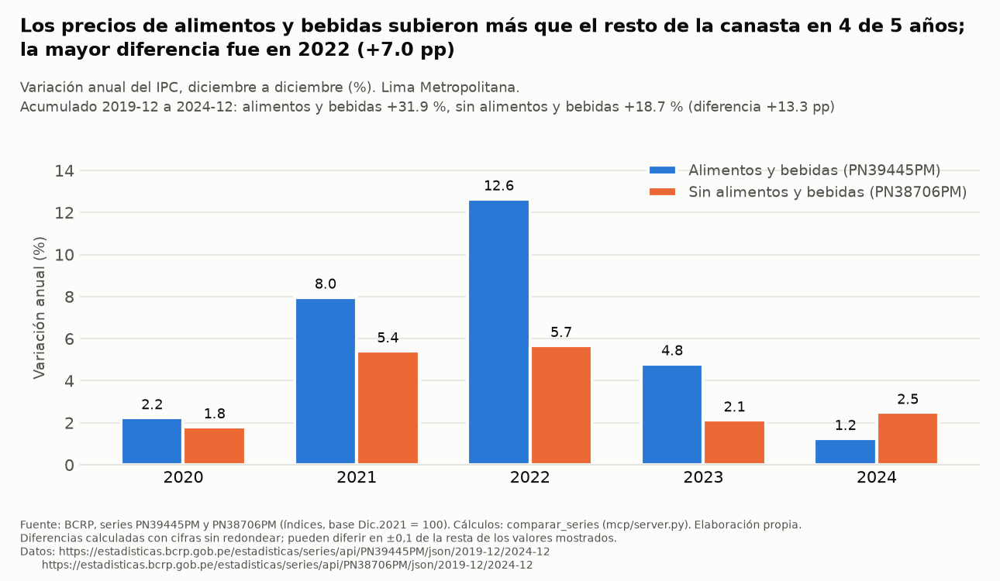
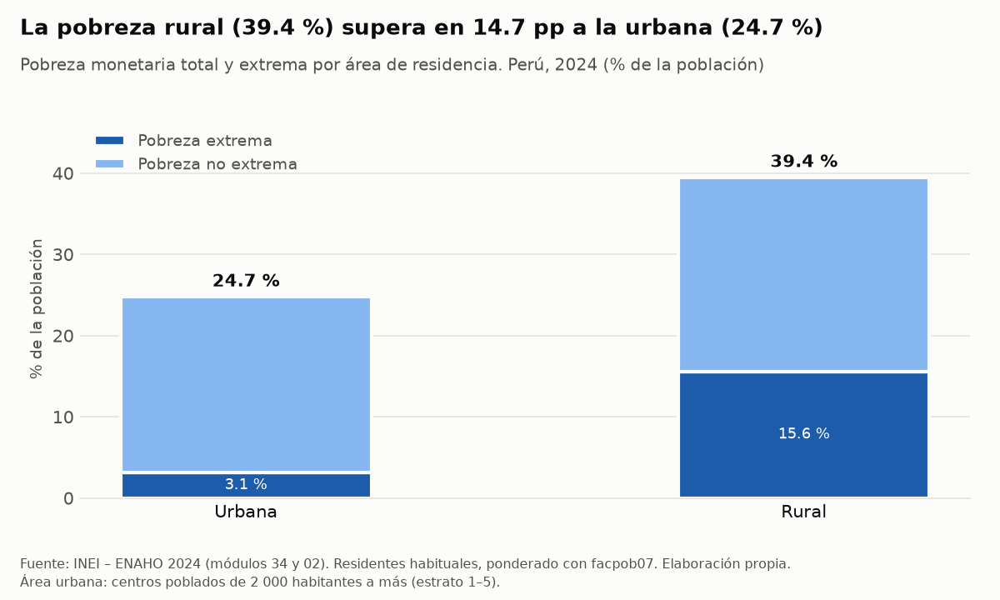
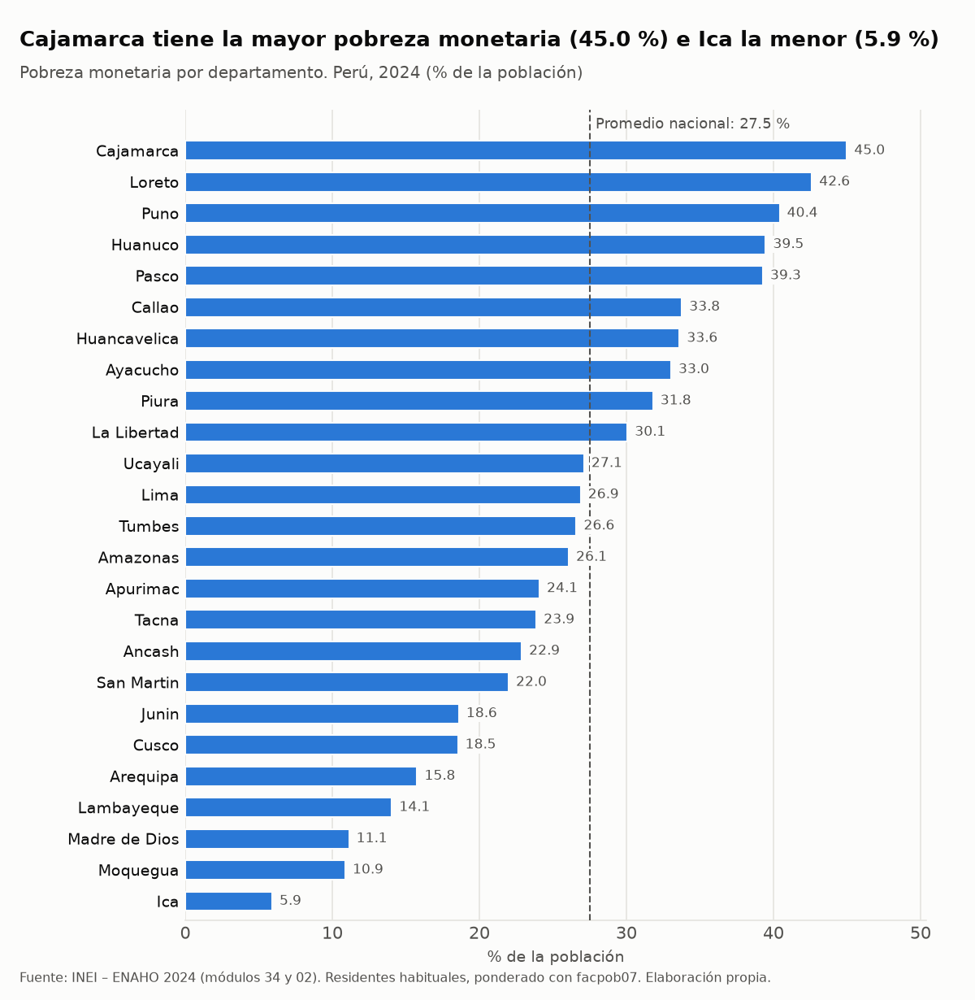
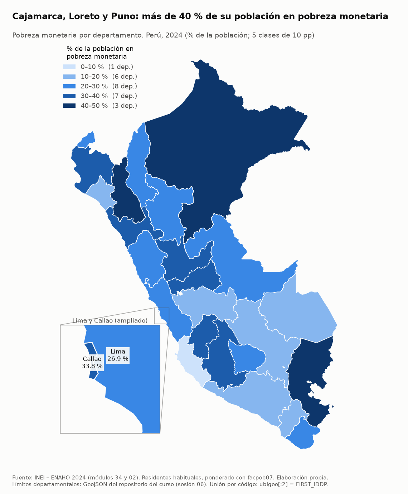

# Informe final – Precios de alimentos (BCRP) y pobreza monetaria (ENAHO 2024)

## 1. Pregunta

¿Cuánto aumentaron los precios de los alimentos frente al resto de la canasta en Lima Metropolitana entre diciembre de 2019 y diciembre de 2024, y qué diferencias de pobreza monetaria había entre departamentos y entre las áreas urbana y rural del Perú en 2024?

## 2. Fuentes y metodología

**BCRP – series mensuales** (API de estadísticas del BCRP, consultada el 8/11/2026 con el servidor MCP propio `bcrp`):

| Código | Serie | Uso |
|---|---|---|
| `PN39445PM` | Índice de precios Lima Metropolitana (índice Dic.2021 = 100) – IPC Alimentos y Bebidas | alimentos |
| `PN38706PM` | Índice de precios Lima Metropolitana (índice Dic.2021 = 100) – IPC Sin Alimentos y Bebidas | resto de la canasta |
| `PN38705PM` | Índice de precios Lima Metropolitana (índice Dic.2021 = 100) – IPC | contexto (IPC total) |

- Herramienta `comparar_series(PN39445PM, PN38706PM, 2019-12, 2024-12)`: variación % de cada índice en el periodo y en cada año (diciembre a diciembre), y diferencia en puntos porcentuales (pp).
- Herramienta `resumen(PN38705PM, 2019-12, 2024-12)`: variación % del IPC total.
- Se usan índices (no tasas), por lo que la variación % es la medida adecuada. Las cuentas las hace Python dentro del MCP; no se hicieron a mano.

**INEI – ENAHO 2024** (módulo 34 `sumaria-2024.dta` y módulo 02 `enaho01-2024-200.dta`), procesada con tres Skills del proyecto:

- `limpiando-enaho`: filtra residentes habituales (`p204/p205/p206`), une personas con hogares (`m:1`), define `pobre = pobreza <= 2`, `urbano = estrato <= 5` (regla de la sesión 16) y `departamento = ubigeo[:2]`; pondera con `facpob07`. Validación: todas las validaciones esenciales OK (`salidas/validacion.txt`).
- `graficando-enaho`: gráficos por área y por departamento (`figuras/`).
- `mapeando-enaho`: mapa coroplético de 25 unidades (Lima y Callao separados), unión por código `ubigeo[:2] = FIRST_IDDP`, y comparación con la referencia de la sesión 16 (`salidas/comparacion_referencia_mapa.csv`).

## 3. Resultados

**Hallazgo 1 – Los alimentos subieron más que el resto de la canasta en el periodo.** Entre dic-2019 y dic-2024, el índice de alimentos y bebidas de Lima Metropolitana subió **31.94 %** (de 90.5906 a 119.5292) y el índice sin alimentos y bebidas **18.69 %** (de 93.1885 a 110.607): diferencia de **+13.25 pp**. Fuente: BCRP, `PN39445PM` y `PN38706PM`, 2019-12 a 2024-12 (`comparar_series`). Como contexto, el IPC total (`PN38705PM`) subió **23.91 %** en el mismo periodo (de 92.14 a 114.1721; `resumen`).

**Hallazgo 2 – La brecha se concentró en 2022 y se invirtió en 2024.** Variación diciembre a diciembre (BCRP, `PN39445PM` vs `PN38706PM`, `comparar_series`):

| Año | Alimentos y bebidas (%) | Sin alimentos y bebidas (%) | Diferencia (pp) |
|---|---|---|---|
| 2020 | 2.24 | 1.80 | +0.44 |
| 2021 | 7.97 | 5.41 | +2.56 |
| 2022 | 12.64 | 5.67 | +6.97 |
| 2023 | 4.80 | 2.13 | +2.68 |
| 2024 | 1.25 | 2.49 | −1.24 |

Los alimentos subieron más que el resto en 4 de los 5 años; en 2024 subieron menos.

**Hallazgo 3 – La pobreza rural supera a la urbana.** En 2024, la pobreza monetaria fue **39.44 %** en el área rural y **24.74 %** en la urbana (diferencia **14.7 pp**, calculada por el script del gráfico con cifras sin redondear); la pobreza extrema, **15.6 %** y **3.13 %**. Nacional: **27.53 %** (extrema 5.5 %). Fuente: INEI – ENAHO 2024, residentes habituales, ponderado con `facpob07` (`salidas/indicadores.csv`).

**Hallazgo 4 – Gran dispersión entre departamentos.** La pobreza va de **5.91 %** en Ica a **44.99 %** en Cajamarca. Tres departamentos superan el 40 %: **Cajamarca (44.99 %)**, **Loreto (42.61 %)** y **Puno (40.42 %)**. 10 de los 25 departamentos (incluido Callao) están por encima del promedio nacional (27.53 %). Lima: 26.89 %; Callao: 33.77 %. Fuente: INEI – ENAHO 2024, residentes habituales, ponderado con `facpob07` (`salidas/indicadores.csv`).

## 4. Visualizaciones

**Gráfico BCRP** – variación anual de los índices de alimentos y bebidas vs. sin alimentos y bebidas, Lima Metropolitana, 2020–2024 (`informes/grafico_bcrp.py`, que usa la función `comparar_series` del MCP):



**Gráfico ENAHO – área** (pobreza total y extrema, urbana vs. rural, 2024):



**Gráfico ENAHO – departamentos** (25 unidades, ordenadas):



**Mapa** (5 clases de 10 pp; Lima y Callao ampliados):



## 5. Interpretación

- En Lima Metropolitana, entre dic-2019 y dic-2024, los precios de alimentos y bebidas acumularon un alza mayor (+31.94 %) que el resto de la canasta (+18.69 %). Las mayores diferencias anuales se dieron en 2021 (+2.56 pp) y 2022 (+6.97 pp); en 2024 la relación se invirtió (−1.24 pp).- En 2024 la pobreza monetaria fue mayor en el área rural que en la urbana y muy desigual entre departamentos: los tres con más de 40 % (Cajamarca, Loreto, Puno) contrastan con Ica (5.91 %).
- Ambas partes describen **hechos distintos** (precios en Lima vs. pobreza en todo el país) y se presentan juntas como contexto. Con estos datos **no se puede afirmar** que el alza de precios de alimentos explique las diferencias de pobreza entre áreas o departamentos.

## 6. Limitaciones

1. **Cobertura geográfica distinta.** Las series del BCRP son de **Lima Metropolitana**; la pobreza es **nacional**, por área y por departamento. No se usaron índices de precios de otras ciudades: el alza de alimentos fuera de Lima no está disponible en este informe.
2. **Periodos distintos.** Los precios cubren **2019–2024**; la pobreza es un **corte de 2024**. No se calculó la pobreza 2019 con la ENAHO, así que no se analiza su evolución.
3. **Diferencia de ponderación** (`limpiando-enaho/reference.md`). Con el método principal (residentes habituales + `facpob07`) la pobreza urbana es 24.74 % y la rural 39.44 %; con el método de la sumaria (`factor07 × mieperho`) 24.81 % y 39.30 %, que coinciden con las referencias del enunciado. La diferencia viene del conteo de personas por hogar (residentes habituales: 108,664; `mieperho`: 109,842). Por departamento llega a +0.52 pp (Puno: 40.42 % vs. 39.9 % de la referencia de la sesión 16); 11 de 25 departamentos difieren ≤ 0.1 pp. No se verificó qué método usa el INEI para su cifra oficial.
4. **Sin intervalos de confianza.** La ENAHO es una muestra; no se calcularon errores estándar ni intervalos, así que no se afirma que diferencias pequeñas (p. ej. entre departamentos con valores cercanos) sean significativas.
5. **Asociación, no causalidad.** Los resultados son descriptivos.
6. **Clasificación urbano/rural.** `urbano = estrato <= 5` es la regla de la sesión 16; no se verificó que sea la definición oficial del INEI (reproduce las referencias urbana/rural con el método de la sumaria).

## 7. Reproducibilidad

Desde la raíz de `tarea_4/` (datos de la ENAHO en `datos/`, ver `limpiando-enaho/reference.md`):

```bash
uv sync
uv run pytest mcp/test_server.py                                    # pruebas del MCP
uv run informes/grafico_bcrp.py                                     # gráfico BCRP
uv run .claude/skills/limpiando-enaho/scripts/limpiar.py            # limpieza y validación
uv run .claude/skills/graficando-enaho/scripts/graficar.py --tipo area
uv run .claude/skills/graficando-enaho/scripts/graficar.py --tipo departamento
uv run .claude/skills/mapeando-enaho/scripts/mapear.py              # mapa + comparación
```

Llamadas MCP (en Claude Code, servidor `bcrp` de `.mcp.json`):

```
comparar_series(codigo_a="PN39445PM", codigo_b="PN38706PM", desde="2019-12", hasta="2024-12")
resumen(codigo="PN38705PM", desde="2019-12", hasta="2024-12")
```

## Verificación de cifras

| # | Afirmación | Valor obtenido | Fuente o procedimiento | Referencia | ¿Coincide? | Diferencia |
|---|---|---|---|---|---|---|
| 1 | Pobreza nacional 2024 | 27.53 % | `limpiar.py` (residentes habituales, `facpob07`) → `salidas/validacion.txt` | 27.6 % ± 0.1 (enunciado, issue #201) | Sí | −0.07 pp |
| 2 | Pobreza rural 2024 | 39.30 % (sumaria) / 39.44 % (`facpob07`) | `limpiar.py` → `salidas/validacion.txt` | 39.3 % (enunciado) | Sí con sumaria; con `facpob07` fuera de ± 0.1 | 0.00 pp / +0.14 pp (ponderación, ver limitación 3) |
| 3 | Pobreza urbana 2024 | 24.81 % (sumaria) / 24.74 % (`facpob07`) | `limpiar.py` → `salidas/validacion.txt` | 24.8 % (enunciado) | Sí | +0.01 pp / −0.06 pp* |
| 4 | Pobreza de Cajamarca (la más alta) | 44.99 % | `mapear.py` → `salidas/comparacion_referencia_mapa.csv` | 45.0 % (sesión 16) | Sí | −0.01 pp |
| 5 | Pobreza de Puno | 40.42 % | `mapear.py` → `salidas/comparacion_referencia_mapa.csv` | 39.9 % (sesión 16) | No al decimal | +0.52 pp (conteo de miembros del hogar) |
| 6 | Alza acumulada alimentos y bebidas | 31.9444 % | `comparar_series` (MCP); recalculado con Python como (119.5292 / 90.5906 − 1) × 100 | 31.9444 % | Sí | 0.0000 |
| 7 | Alza acumulada IPC total | 23.9115 % | `resumen` (MCP); recalculado con Python como (114.1721 / 92.14 − 1) × 100 | 23.9115 % | Sí | 0.0000 |
| 8 | Índice de alimentos y bebidas (`PN39445PM`), dic-2019 y dic-2024 | 90.5906 y 119.5292 (MCP) | **Verificación manual** en la web del BCRP (estadisticas.bcrp.gob.pe), 8/11/2026 | 90.59 y 119.53 (web, 2 decimales) | Sí | 0.0006 y 0.0008 |
| 9 | Índice IPC total (`PN38705PM`), dic-2019 y dic-2024 | 92.14 y 114.1721 (MCP) | **Verificación manual** en la web del BCRP (estadisticas.bcrp.gob.pe), 8/11/2026 | 92.14 y 114.17 (web, 2 decimales) | Sí | 0.0000 y 0.0021 |

\* Diferencias de las filas 1–3 calculadas con Python (valor obtenido − referencia); las de las filas 4–5 vienen de `salidas/comparacion_referencia_mapa.csv`. Las filas 6–7 comprueban la aritmética con los niveles del índice devueltos por la API del BCRP; no son una fuente independiente de los niveles. Las filas 8–9 verifican esos niveles contra la web del BCRP de forma manual (fuente independiente del MCP), por lo que las variaciones de las filas 6–7 quedan respaldadas.

## Errores detectados y corregidos durante el desarrollo

| # | Problema | Cómo se detectó | Corrección |
|---|---|---|---|
| a | En una prueba del prompt `informe`, el agente afirmó que no había datos posteriores a 2026-09. Era **falso**: las series tienen dato de 2026-10. | Revisión humana del texto y consulta con `serie` hasta 2026-10. | Se añadió la regla 7 al prompt `informe` del MCP: “Para saber hasta cuándo hay datos, consulta la serie hasta la fecha actual; no lo supongas”. |
| b | La validación de pobreza rural **falló** (39.44 % vs. 39.3 % ± 0.1) y la Skill de limpieza se detuvo. | Validación automática de `limpiar.py` (código de salida 1). | Diagnóstico: con `factor07 × mieperho` se obtiene 39.30 %; la diferencia viene del conteo de miembros del hogar, no del factor ni de un error de datos. **No se amplió la tolerancia**: urbano/rural se validan con el método que reproduce la referencia y las cifras con `facpob07` se informan con su diferencia (`limpiando-enaho/reference.md`). |
| c | Diferencias mostradas en gráficos (p. ej. 7.0 pp en 2022) no coincidían con la resta de los valores redondeados mostrados (12.6 − 5.7 = 6.9). | Revisión humana de los gráficos. | Regla única: diferencias con cifras sin redondear y nota al pie en los gráficos; se corrigió un gráfico que usaba otra regla. |
| d | La afirmación “urbano = centros poblados de 2 000 habitantes a más” se había presentado como definición oficial. | Revisión humana. | Se precisó que es la regla de la sesión 16 leída con las etiquetas de `estrato`, no verificada como definición oficial del INEI (limitación 6). |

